# GoGlow UI/UX Specification

## 0. Authoring Context & Session Integrity — Read First

- **Authoring role:** Gemini (UI/UX Designer), assigned in `docs/multi-agent-work-plan.md`.
- **Review target:** ChatGPT (Integration Lead & Architect) and Grok (Independent Adversarial QA).
- **Scope boundary:** This document is a **design specification and acceptance standard only**. In strict accordance with the multi-agent work plan, no application code (`app/index.html`, `src/goglow/*`), shared schemas (`specs/*`), or companion agent documents (`docs/qa-acceptance.md`, `docs/media-qc-protocol.md`) were modified in this phase.
- **Verification status in this session:** No live browser execution or automated test runner was invoked. All UI flows, screen states, component behaviors, and acceptance criteria are derived analytically from static analysis of `README.md`, `AGENTS.md`, `docs/architecture.md`, `docs/workflow.md`, `app/index.html`, `specs/scene-plan.schema.json`, `specs/character-profile.schema.json`, `docs/qa-acceptance.md` (PR #1), and `docs/media-qc-protocol.md` (PR #2).
- **Reconciliation updates (post-ChatGPT Tech Lead review, 2026-10-21):**
  1. Reconciled severity scales: adopted `BLOCKER` / `MAJOR` / `MINOR` / `NOTE` for media review defects (aligned with `docs/media-qc-protocol.md`), keeping software QA defects strictly labeled `P0`–`P3` (aligned with `docs/qa-acceptance.md`).
  2. Designated `docs/media-qc-protocol.md` Section 2.3 as the canonical source of truth for mapping QC outcomes to project workflow states.
  3. Clarified manual user declaration vs automated app verification: M1 does not verify media files; entering `media_uri` and ticking confirmation is a manual user declaration, not automated file verification or QC approval.
  4. Unified duration export rules with `docs/workflow.md`: export is strictly blocked when scene duration sum does not equal target duration, with no bypass button; scene durations are never auto-adjusted without explicit user action.
  5. Clarified activity constraints and Continuity Bridge as human-director lint helpers, not claims of automated physics/vision verification.
- **Non-negotiable honesty rule:** No automated Google Flow interface, direct model API calls, or automatic vision QC are invented or claimed. All integrations remain classified as future work.

---

## 1. Product Vision & Design Principles

GoGlow is a local-first, privacy-preserving production planning and quality-control tool for AI character videos (primarily targeted at vertical short-form formats like 9:16 and runtimes > 30 seconds).

### 1.1 Core Design Pillars

1. **Local-First & Zero-Trust Privacy:**
   - Creative assets (character reference images, project briefs, scene prompts) belong on the user's local machine.
   - Reference images are loaded via temporary in-memory Object URLs (`URL.createObjectURL()`) for in-session preview only.
   - Raw image binary data or base64 strings **must never** be stored in `localStorage`, sent to external servers, or bundled into project JSON/Markdown exports.
2. **Truthful State Machine (No Illusory Completion & No Verification Overclaims):**
   - A planned prompt is not an attempted generation. A generated clip is not a passed QC check.
   - Addressing Grok QA Finding #2 (P0) & ChatGPT review: GoGlow M1 has no automated file-system scanner, video decoder, or media inspection engine; it cannot independently prove that a video file exists, is accessible, or is playable.
   - Therefore, entering a `media_uri` and ticking a confirmation box is strictly a **manual user declaration** (`khai báo thủ công của người dùng`) to track workflow state, not automated verification.
   - Having a `media_uri` does **not** mean the clip has passed QC or is approved. Transitioning to `APPROVED` remains strictly gated behind human visual QC per `docs/media-qc-protocol.md`. The UI enforces this manual declaration gate to prevent accidental status jumps, without claiming false status defects are completely eliminated by code alone.
3. **Strict Validation & Real-Time Production Guardrails:**
   - Addressing Grok QA Finding #1 (P2): The UI enforces `9:16` as the only verified aspect ratio for M1, preventing validator rejections down the pipeline.
   - Addressing Grok QA Finding #3 (P2) & `docs/workflow.md`: The UI calculates and displays the duration discrepancy between target duration and total scene durations in real time. If the sum does not equal `target_duration_seconds`, export actions are strictly **blocked** with no bypass option. Scene durations are never altered automatically without explicit user confirmation.
4. **Frictionless Handoff for Manual Generation:**
   - Since no direct Google Flow API exists, the UI is optimized for fast, accurate manual generation: one-click prompt copying, clear parameter readouts (model label, camera, seed, duration), and a structured checklist for human QC.
5. **Accessible & Responsive:**
   - Functional on desktop displays (primary production environment) and responsive down to mobile viewports for reference viewing or field notes. Fully operable via standard keyboard shortcuts.

---

## 2. Information Architecture (IA) & App Layout

The GoGlow application uses a 3-tier layout:
1. **Global App Bar (Top):** Project identity, project selector/manager, global actions (Save, New, Import, Export), and duration health status badge.
2. **Main Production Canvas (Center Split):**
   - **Left Panel (340px fixed on desktop, collapsible on mobile):** Project metadata, character profile & identity anchors, reference image gallery, and target parameters.
   - **Right Panel (Fluid flex):** Scene sequence timeline overview, scene cards list, continuity connectors, and quick-action bar.
3. **Auxiliary Modals / Drawers:** Project Manager Modal, Media Declaration & QC Review Dialog, Duration Redistribution Modal, Export / Import Modal.

```
+-----------------------------------------------------------------------------------------------------+
| [Brand: GoGlow]  [Project Switcher: "Cycling in Park v1" v]  (Duration: 36/36s OK) [Save] [Export v] [Import] |
+------------------------------------+----------------------------------------------------------------+
| LEFT SIDEBAR: CONFIG & CHARACTER   | RIGHT WORKSPACE: SCENE SEQUENCER                               |
| ---------------------------------- | -------------------------------------------------------------- |
| * Project Settings                 | [Timeline Bar: | S1 (9s) | S2 (9s) | S3 (9s) | S4 (9s) |]              |
|   - Activity: Cycling [v]          |                                                                |
|   - Target Duration: 36s           | [Scene Card 01: S01] [Status: PROMPT_READY]                    |
|   - Aspect Ratio: 9:16 (Locked M1) |   - Start State / Primary Action / End State                   |
|   - Brief / Setting                |   - Motion, Camera, Wardrobe, Environment                      |
|                                    |   - Prompt Box (Editable) [Copy] [Sync]                        |
| * Character Profile & Anchors      |                                                                |
|   - Name: "Elena"                  | [=== Continuity Bridge: S01 -> S02 (Verified) ===]             |
|   - Identity Anchors Tags          |                                                                |
|   - Wardrobe Preset                | [Scene Card 02: S02] [Status: PLANNED]                         |
|                                    |   - Start State / Primary Action / End State                   |
| * Reference Asset Gallery          |   - Prompt Box (Editable) [Copy] [Sync]                        |
|   - [Img 1: Identity] [Img 2: Pose]|                                                                |
|   - [+ Add Reference Image]        | [+ Add Scene]                                                  |
+------------------------------------+----------------------------------------------------------------+
```

---

## 3. Detailed User Journeys

### Journey 1: Project Lifecycle (Create, List, Reopen, Switch, Delete)

- **Entry Point:** Global App Bar.
- **Workflow:**
  1. **New Project:** User clicks `[+ Dự án mới]`. If unsaved changes exist in the active project, an alert modal warns: *"Dự án hiện tại có thay đổi chưa lưu. Bạn có muốn lưu hoặc xuất JSON trước khi tạo dự án mới?"* with options: `[Hủy]`, `[Bỏ qua thay đổi]`, `[Lưu & Tạo mới]`.
  2. **Starter Preset Selection:** Modal prompts for:
     - Project Name (default: *"Video mới - [Date]"*)
     - Activity (options: `cycling`, `yoga`, `dance`, `fashion`, `other`)
     - Target Duration (number, min 31s, default 36s)
     - Initial Scene Count (number, 1–20, default 4)
  3. **Auto-Scaffolding:** Upon clicking `[Tạo kế hoạch]`, GoGlow executes deterministic scene breakdown: distributes duration evenly, populates starter action beats matching the selected activity, and builds initial prompts.
  4. **Project Switcher & Local Registry:**
     - All projects are indexed in `localStorage` under key `goglow_project_index` (`[{id, name, activity, updated_at, scene_count}]`).
     - Clicking the project title opens a dropdown/modal displaying existing local projects with metadata, a `[Xóa]` button (with confirmation), and an `[Xuất JSON]` quick-action.
  5. **Import Project:** User can click `[Nhập JSON]` to upload an existing `goglow-project.json` or scene plan. The schema validator verifies the payload; valid projects load immediately, while malformed files produce a descriptive error alert without crashing the app.

---

### Journey 2: Character Profile & Reference Image Management

- **Location:** Left Sidebar -> Section "Hồ sơ nhân vật & Ảnh tham chiếu".
- **Fields & Controls:**
  - **Character Name:** Input text (`main_character_name`).
  - **Character Description:** Short textarea for core personality, age, ethnicity, build.
  - **Identity Anchors (Tags/Tokens):** Dynamic token input (e.g., `["nốt ruồi đuôi mắt trái", "tóc đen ngang vai", "dáng thể thao"]`).
    - *UI Mechanism:* User types tag + press `Enter` or `,`. Each tag renders as a removable chip `[Tag X]`.
    - *Purpose:* Automatically appended to scene prompt negative/positive constraints to prevent character drift in generation models.
  - **Wardrobe Variants:** Simple selector or input for outfit in current scene (e.g., *"Đồ thể thao xanh thẫm, giày chạy trắng"*).
  - **Reference Image Manager (Privacy-Preserved):**
    - File input button: `[+ Tải ảnh tham chiếu]` (accepts `image/png, image/jpeg, image/webp`, multiple files allowed).
    - In-memory processing: Creates temporary object URLs using `URL.createObjectURL(file)`.
    - **Reference Card Component:**
      - Thumbnail preview (70x90px, object-fit: cover, rounded corners).
      - Role Selector Dropdown: `identity` (mặt/danh tính), `wardrobe` (trang phục), `pose` (dáng/thế), `first_frame` (khung đầu), `last_frame` (khung cuối), `scene` (bối cảnh), `prop` (đạo cụ). Matches `specs/character-profile.schema.json`.
      - Description note input: Short text explaining what this image anchors.
      - Delete button `[x]`: Revokes object URL via `URL.revokeObjectURL()` and removes card.
    - **Privacy Notice Badge:** Prominent info alert:
      > *"Bảo mật dữ liệu: Ảnh chỉ hiển thị trong phiên trình duyệt này qua bộ nhớ đệm (Object URL). Ảnh KHÔNG được tải lên máy chủ và KHÔNG được lưu vào JSON/Markdown để đảm bảo an toàn."*

---

### Journey 3: Project Configuration & Target Constraints

- **Location:** Left Sidebar -> Section "Thông số dự án".
- **Fields & Validations:**
  - **Activity (`activity`):** Dropdown selector:
    - `cycling` (Đạp xe)
    - `yoga` (Yoga)
    - `dance` (Nhảy / Vũ đạo)
    - `fashion` (Thời trang / Runway)
    - `other` (Khác)
    - *Behavior on Change:* Prompts user: *"Đổi hoạt động sẽ cập nhật mẫu hành động khởi tạo cho các cảnh chưa chỉnh sửa. Bạn có muốn tiếp tục?"*
  - **Target Duration (`target_duration_seconds`):**
    - Numeric input, integer only, `min: 31`, `step: 1`, default: `36`.
    - Invalid state (< 31 or NaN): Highlights red border with error text: *"Thời lượng mục tiêu phải là số nguyên ≥ 31 giây."*
  - **Aspect Ratio (`aspect_ratio`):**
    - Standard value: `9:16` (Vertical / Khung dọc).
    - In M1, this field is locked to `9:16` with a helper tag: `[Mặc định chuẩn Flow M1]`. Options `16:9` and `1:1` are disabled and annotated: `[Chưa kiểm thử cho Flow M1 - Vô hiệu hóa]`, resolving Grok Finding #1.
  - **Project Brief (`brief`):** Textarea describing environment, mood, lighting, overarching storyline.
  - **Model Verification Labels (`model_labels`):**
    - Video Model Name input (placeholder: *"e.g., Flow Omni 1.1"*).
    - Image Model Name input (placeholder: *"e.g., Nano Banana Pro"*).
    - Helper note: *"Ghi nhận nhãn chính xác đang hiển thị trong giao diện Flow. Không bịa đặt tên model."*

---

### Journey 4: Scene Planning & Sequencing

- **Location:** Main Workspace -> Right Panel.
- **Timeline Overview Bar:**
  - Displays a visual sequence bar showing each scene's proportional duration.
  - Color-coded by status:
    - Grey: `PLANNED`
    - Blue: `PROMPT_READY`
    - Orange: `WAITING_FOR_GENERATION`
    - Purple: `GENERATED`
    - Yellow: `QC_REVIEW` / `NEEDS_REVISION`
    - Green: `APPROVED`
    - Red: `BLOCKED` / `REJECTED`
  - Real-time Duration Budget Indicator:
    - Display format: `Tổng thời lượng cảnh: X / Y giây [Chênh lệch: Z giây]`.
    - If `X == Y`: Green badge `[Đủ thời lượng: Khớp mục tiêu]`. Export buttons are enabled.
    - If `X != Y`: Amber/Red error badge `[Sai lệch Z giây — Chặn xuất]`. Export buttons are disabled.
    - Optional helper button: `[Cân đối lại thời lượng]` (opens preview modal for explicit user confirmation; never applies automatically).
- **Scene Card Architecture:**
  Each scene renders as a structured card containing:
  1. **Header Row:**
     - Drag handle (for reordering).
     - Scene Index & ID: `Cảnh 01 (scene-01)`.
     - Duration Input: `Thời lượng (giây)` (positive number).
     - Status Selector (Guarded by manual declaration, see Journey 6).
     - Quick Action Menu: `[Sao chép cảnh]`, `[Xóa cảnh]`.
  2. **Core Motion & Beat Grid (2 columns):**
     - `Trạng thái bắt đầu (start_state)`: Character pose, position, camera framing at t=0.
     - `Hành động chính (primary_action)`: Exactly one dominant action occurring in this shot.
     - `Trạng thái kết thúc (end_state)`: Precise resting pose and position at scene conclusion.
     - `Hướng & Tốc độ (motion_direction)`: Explicit screen direction (e.g., *"Di chuyển từ trái sang phải màn hình với tốc độ đều"*).
     - `Cơ học cơ thể & Ràng buộc (body_mechanics)`: Activity-specific physical realism guidelines (e.g., pedal contact, joints, foot placement). Labeled as *Director's heuristic checklist*, not automated physics checks.
     - `Thiết lập Camera (camera)`: Fixed angle, tracking mode, lens distance.
     - `Trang phục cảnh (wardrobe)`: Outfit worn in this scene (defaults to character preset).
     - `Địa điểm / Bối cảnh (location)`: Specific background landmarks.
     - `Điều cần tránh (negative_constraints)`: Tags/Text (e.g., *"Không đảo hướng, không biến dạng tay lái, không đổi trang phục"*).
     - `QC Checklist`: Activity-specific quality checklist items derived from `docs/media-qc-protocol.md` with defect severity options: `BLOCKER`, `MAJOR`, `MINOR`, `NOTE`.
  3. **Deterministic Prompt Studio:**
     - Formatted Prompt Box (monospaced textarea).
     - Action Buttons:
       - `[Tái tạo prompt từ các trường]` (`Sync`): Reassembles prompt deterministically from structured inputs + character anchors.
       - `[Sao chép prompt]` (`Copy`): Copies text to system clipboard. Triggers inline toast notification: *"Đã sao chép prompt của Cảnh X vào clipboard."*

---

### Journey 5: Continuity Management Between Adjacent Scenes

- **Component:** "Continuity Bridge" rendered between `Scene[i]` and `Scene[i+1]`.
- **Functionality (Director's Lint Helper):**
  - Compares `Scene[i].end_state` with `Scene[i+1].start_state`.
  - If `Scene[i+1].start_state` begins with `"Continue from previous ending state..."` or matches ending keywords: displays green link badge `[Liên tục: Khớp trạng thái]`.
  - If a potential continuity contradiction is detected (e.g., Scene 1 ends on *"Rider moving right-to-left"* while Scene 2 starts with *"Rider moving left-to-right"*): displays an amber warning chip:
    > `[Cảnh báo liên tục]: Hướng di chuyển hoặc tư thế kết thúc của Cảnh trước có thể không khớp với điểm bắt đầu Cảnh sau. Hãy kiểm tra lại.`
  - Explicit disclaimer: *"Cảnh báo mang tính hỗ trợ biên tập (heuristic lint), không thay thế việc kiểm tra thực tế bằng mắt."*
  - Quick action: `[Sao chép điểm kết thúc Cảnh trước làm điểm bắt đầu]` button to automatically synchronize states.

---

### Journey 6: Generation & Production Status Workflow (Honest State Machine)

To enforce rule #2, align with `docs/media-qc-protocol.md` Section 2.3 (canonical source), and address Grok QA Finding #2 without overclaiming automated verification:

```mermaid
stateDiagram-v2
    [*] --> PLANNED
    PLANNED --> PROMPT_READY : Operator finalizes prompt & settings
    PROMPT_READY --> WAITING_FOR_GENERATION : Prompt copied to clipboard for Flow
    WAITING_FOR_GENERATION --> GENERATED : Operator manually declares media_uri
    GENERATED --> QC_REVIEW : Open for human review checklist
    QC_REVIEW --> APPROVED : PASS (human QC: no unresolved BLOCKER or MAJOR defects)
    QC_REVIEW --> NEEDS_REVISION : FAIL (human QC: MAJOR defect found; narrow revision needed)
    QC_REVIEW --> REJECTED : FAIL (human QC: BLOCKER defect found; clip unusable)
    NEEDS_REVISION --> PROMPT_REVISED : Prompt updated with revision notes
    PROMPT_REVISED --> WAITING_FOR_GENERATION : Ready for regeneration
    PLANNED --> BLOCKED : Missing asset or reference
    PROMPT_READY --> BLOCKED : Missing required parameter
    GENERATED --> BLOCKED : Operator reports clip inaccessible/unplayable
```



#### Canonical Mapping from QC Report to UI Workflow
Per `docs/media-qc-protocol.md`, Section 2.3:

| QC Report Outcome | UI Status Transition & Action |
|---|---|
| `PASS` (no unresolved `BLOCKER` or `MAJOR` defects) | Eligible for human sign-off to `APPROVED`. QC PASS alone is not approval to publish. |
| `REVIEW` (open checks remain) | Remains in `QC_REVIEW`. Highlight open categories before decision. |
| `FAIL` with a `MAJOR` defect | Moves to `NEEDS_REVISION`. Opens narrow revision prompt editor. |
| `FAIL` with a `BLOCKER` defect | Moves to `REJECTED`. Blocks assembly. Requires regeneration or re-planning. |
| `NOT_REVIEWED` (clip inaccessible or uninspected) | Remains in `GENERATED` / `QC_REVIEW` with no decision. Cannot be assembled or approved. |

#### Severity Scale Separation (Crucial Architectural Rule)
- **Media Defect Severity (Clips & Video):** Evaluated strictly as `BLOCKER` / `MAJOR` / `MINOR` / `NOTE` per `docs/media-qc-protocol.md`.
- **Software QA Severity (Code & Product):** Evaluated strictly as `P0` / `P1` / `P2` / `P3` per `docs/qa-acceptance.md`.
- The two vocabularies are kept strictly distinct across the UI and documentation. `P0`–`P3` is never used to describe clip defects.

#### Manual Declaration vs Automated Verification in UI:
1. **Initial State:** Default initial state is `PLANNED`.
2. **Advancing to Generation:** Clicking `[Sao chép prompt]` offers to advance status to `PROMPT_READY` or `WAITING_FOR_GENERATION`.
3. **Manual Declaration Gate for Media:**
   - Because GoGlow M1 has no automated video ingestion or file inspection engine, the UI relies strictly on **manual user declarations** (`xác nhận thủ công của người dùng`).
   - If user attempts to select `GENERATED`, `QC_REVIEW`, or `APPROVED` without a declared `media_uri`:
     - The transition is intercepted.
     - The **"Khai báo tệp media tạo ngoài (Manual User Declaration)"** modal opens, requiring:
       - Media URI input: local path (e.g., `file:///D:/clips/scene-01.mp4`) or storage URI entered by the user.
       - Actual model label as displayed in Flow UI.
       - Optional generation seed or prompt version.
       - Manual declaration checkbox: `[x] Xác nhận thủ công: Tôi đã tự tạo và kiểm tra clip này ngoài ứng dụng, khai báo URI để theo dõi.`
       - Explicit UI disclaimer:
         > *"Lưu ý: GoGlow M1 không tự động quét hay kiểm tra tệp video. Việc khai báo URI không chứng minh file tồn tại hoặc phát được, không đồng nghĩa clip đã đạt QC hay được duyệt."*
     - Only after this declaration does the scene transition to `GENERATED`.
4. **Transition to `APPROVED` Requires Human QC:**
   - Having a `media_uri` does **not** equal QC approval.
   - A scene can only transition to `APPROVED` after a human operator opens the Mini QC Modal, completes the checklist, confirms `PASS` with zero unresolved `BLOCKER` or `MAJOR` defects, and signs off with reviewer name and date.
5. **Handling Missing Clip Access vs Missing Specific Evidence (Operator Decision):**
   - **Clip access missing:** If the operator reports that the video file cannot be opened, played, or accessed, the operator marks the review as `BLOCKED` in the tracker and `NOT_REVIEWED` in the QC report. The checklist is disabled until a playable file is provided.
   - **Evidence for a specific check missing:** If the clip is playable, but a specific check cannot be confirmed (e.g., foot pedal contact hidden by deep shadow), the operator selects `NOT_CHECKED` or `REVIEW` for that individual check. This puts the scene into `REVIEW` status, without falsely treating the entire clip as unreviewable (`NOT_REVIEWED`).
6. **Wardrobe Category Serialization:**
   - Wardrobe defects affecting character identity are recorded under `identity`.
   - Outfit/accessory defects that do not alter character identity are recorded under `other`, and the UI automatically prepends `wardrobe:` to the notes field, adhering to schema constraints without data loss.

---

### Journey 7: Export & Backup

- **Export Actions:** Header buttons `[Xuất JSON]` and `[Xuất Markdown]`.
- **Strict Export Block Rule on Duration Mismatch (No Bypass):**
  - Aligned with `docs/workflow.md` (which mandates that scene durations must sum to target duration) and `src/goglow/validator.py`:
  - The UI continuously calculates:
    $$\Delta = \sum \text{scene.duration\_seconds} - \text{target\_duration\_seconds}$$
  - **If $\Delta \neq 0$:**
    - Both Export buttons (`[Xuất JSON]` and `[Xuất Markdown]`) are **strictly disabled/blocked** with a lock badge and visual warning state.
    - If user hovers or clicks, a blocking banner displays:
      > *"Không thể xuất: Tổng thời lượng các cảnh (X giây) không bằng thời lượng mục tiêu (Y giây). Chênh lệch: Z giây. Vui lòng điều chỉnh thời lượng các cảnh bằng nhau trước khi xuất."*
    - **No bypass option:** There is no confirmation dialog, override button, or "proceed anyway" option to bypass this constraint.
    - **No silent/automatic duration modification:** GoGlow never automatically alters scene durations without an explicit user action.
    - **Redistribution Helper:** The user may manually edit individual scene duration inputs, or click the optional helper button `[Cân đối lại thời lượng]`.
      - Clicking the helper opens a preview modal displaying the proposed even redistribution (`divmod(target, count)`).
      - Changes are applied **only after the user explicitly clicks `[Xác nhận áp dụng]`**, preventing unintended overwriting of custom timings.
  - **If $\Delta == 0$ and all required fields are valid:**
    - Export buttons are active and enabled.
    - Generates downloadable `goglow-project.json` (100% compliant with `specs/scene-plan.schema.json`).
    - Generates downloadable `goglow-plan.md` production packet.
    - Status bar displays: *"Đã xuất thành công tệp goglow-project.json lúc HH:MM:SS"*.

---

## 4. UI States & Edge Cases

| State Category | Screen / Component | User Experience & Visual Treatment |
|---|---|---|
| **Empty State** | Scene Workspace | When project has 0 scenes, displays friendly illustration and text: *"Chưa có cảnh nào trong kế hoạch. Hãy thiết lập thông số bên trái và bấm 'Tạo kế hoạch cảnh' hoặc bấm '+ Thêm cảnh'."* |
| **Empty State** | Reference Box | When no reference images are chosen: *"Kéo thả hoặc chọn ảnh chân dung, toàn thân, trang phục để đối chiếu. Ảnh được bảo vệ an toàn trong phiên."* |
| **Loading State** | Project Import | Spinner overlay with text: *"Đang phân tích cấu trúc dự án và kiểm tra tính hợp lệ..."* |
| **Validation Error** | Duration Discrepancy | Timeline bar turns amber/red; duration counter pulses: *"32s / 36s (-4s)"*; Export buttons are strictly disabled; tooltip explains exact discrepancy; no bypass button provided. |
| **Validation Error** | Duplicate Scene ID | Input field highlights in red with tooltip: *"Mã cảnh đã tồn tại, vui lòng đổi tên khác."* |
| **Unsaved Changes** | App Header | Shows an amber dot and label: `● Có thay đổi chưa lưu`. Triggering page reload/close fires browser `beforeunload` dialog: *"Bạn có thay đổi chưa lưu trong dự án GoGlow."* |
| **Storage Error** | `localStorage` full | If browser storage quota is exceeded, shows error banner: *"Bộ nhớ trình duyệt đã đầy. Vui lòng sử dụng nút 'Xuất JSON' để lưu dự án về máy tính."* |
| **Corrupted Data** | Restore failure | If cached JSON in `localStorage` is malformed, app does not crash; it logs a silent fallback, resets to a fresh default project, and notifies: *"Không thể đọc bản lưu cũ bị lỗi. Đã khởi tạo dự án mới an toàn."* |

---

## 5. Mobile & Responsive Layout Adaptations

- **Breakpoint Desktop (≥ 1024px):**
  - Side-by-side 2-column layout (Sidebar 340px fixed, Workspace flex 1).
  - All tools and timeline visible simultaneously.
- **Breakpoint Tablet (768px – 1023px):**
  - Sidebar narrows to 280px or collapses into an off-canvas drawer toggled via `[☰ Cấu hình]`.
  - Workspace displays 2-column grid for scene fields.
- **Breakpoint Mobile (< 768px):**
  - Single-column vertical layout.
  - Top bar features a bottom-sheet tab bar: `[1. Cấu hình]`, `[2. Danh sách cảnh]`, `[3. Tổng kết / Xuất]`.
  - Sticky bottom action bar with `[Lưu dự án]` and `[Sao chép prompt cảnh hiện tại]`.
  - Field grids stack into a single vertical column. Touch targets enlarged to min 44x44px.

---

## 6. Accessibility (a11y) & Keyboard Ergonomics

1. **WCAG 2.1 AA Compliance:**
   - Color contrast ratio of text against backgrounds is at least `4.5:1` (e.g., `#176b50` on white is `5.1:1`, body text `#17221c` on `#f3f6f3` is `12.5:1`).
   - Focus visible indicators: 2px solid green ring with 2px offset on all focused inputs, buttons, and links.
2. **Semantic Elements:**
   - Uses `<header>`, `<main>`, `<aside>`, `<section>`, `<article>`, `<nav>`.
   - Form fields have associated `<label>` tags with matching `for` attributes.
3. **Screen Reader Announcements (`aria-live`):**
   - Live region (`aria-live="polite"`) for status notices: *"Đã sao chép prompt"*, *"Đã lưu dự án"*, *"Lỗi xác thực: tổng thời lượng chưa khớp, xuất bị chặn"*.
4. **Keyboard Shortcuts:**
   - `Ctrl + S` / `Cmd + S`: Trigger project save to `localStorage`.
   - `Ctrl + Shift + E` / `Cmd + Shift + E`: Trigger JSON export (only active when duration sum matches).
   - `Alt + N`: Add new scene to sequence.
   - `Escape`: Close any open modal dialog.

---

## 7. Concrete Acceptance Criteria (Gherkin Format)

### AC-1: Strict Export Blocking on Duration Sum Mismatch
```gherkin
Scenario: User alters scene duration causing total mismatch and attempts export
  Given the project target duration is set to 36 seconds
  And Scene 1 is 9s, Scene 2 is 9s, Scene 3 is 9s, Scene 4 is 9s (total 36s)
  When the user edits Scene 1 duration from 9s to 12s (total 39s)
  Then the duration budget meter immediately updates in real time to display "39s / 36s (+3s)" in error state
  And both the "Xuất JSON" and "Xuất Markdown" export actions are strictly disabled and blocked
  And no bypass or "export anyway" confirmation button is provided to the user
  When the user clicks "[Cân đối lại thời lượng]"
  Then a preview modal appears displaying the proposed redistribution (9s, 9s, 9s, 9s) without modifying the scene cards yet
  When the user clicks "[Xác nhận áp dụng]" in the modal
  Then scene durations update to match the target duration (36s total)
  And the duration meter updates to "36s / 36s (Đủ thời lượng: Khớp mục tiêu)"
  And the Export JSON and Export Markdown buttons become enabled
```

### AC-2: Manual Declaration Gate and Human QC Requirement for Approval
```gherkin
Scenario: User attempts to advance scene without declared media and human QC
  Given Scene 1 has status "PLANNED" and no declared "media_uri"
  When the user attempts to change status directly to "APPROVED"
  Then the transition is blocked by the UI
  And a notice informs the user that a declared media_uri and a completed human QC review (PASS) are required
  When the user declares a media_uri and ticks the manual confirmation checkbox
  Then the scene transitions to "GENERATED" (not "APPROVED")
  And the UI explicitly notes that declaring a media_uri does not verify file validity or constitute QC approval
  When human QC is subsequently recorded with status "PASS" and zero BLOCKER or MAJOR defects
  Then the operator can transition the scene to "APPROVED"
```

### AC-3: Privacy Preservation for Reference Images
```gherkin
Scenario: User uploads character reference photos
  Given the user selects 3 local JPG images in the reference file picker
  When the files are loaded by the browser
  Then object URLs are generated for local image preview cards
  And no network request is sent to any server
  When the user exports "goglow-project.json"
  Then the JSON file contains only reference metadata ("id", "role", "note")
  And contains zero base64 image strings or binary payloads
```

### AC-4: Aspect Ratio Lock for M1
```gherkin
Scenario: Aspect ratio selector reflects M1 verified limits
  Given the user opens project settings
  When inspecting the Aspect Ratio control
  Then "9:16" is selected and marked as default
  And options for "16:9" or "1:1" are disabled or labeled as unverified for Flow M1
```

### AC-5: Continuity Bridge State Linking (Director Lint)
```gherkin
Scenario: Automatic continuity propagation from prior scene
  Given Scene 1 has end_state "Rider stops next to a wooden bench facing east."
  When the user adds Scene 2
  Then Scene 2 start_state is pre-populated with "Continue from previous ending state. Rider stops next to a wooden bench facing east."
  And the visual continuity connector between Scene 1 and Scene 2 displays a "Connected" status
  And an informative caption notes this is a human-review lint helper
```

### AC-6: Prompt Deterministic Synchronization
```gherkin
Scenario: Updating scene motion fields updates generated prompt
  Given Scene 1 has primary_action "Pedal forward smoothly"
  When the user edits primary_action to "Sprint forward aggressively standing on pedals"
  And clicks "Cập nhật prompt từ các trường"
  Then the prompt textarea updates to include the new primary action text
  And existing character anchors and constraints are preserved
```

### AC-7: Missing Clip Access vs Missing Specific Evidence
```gherkin
Scenario: Distinguishing unplayable clips from unverified checklist items
  Given Scene 1 has a declared media_uri attached
  When the operator inspects the clip and cannot confirm foot pedal contact due to deep shadow
  Then the operator marks "physics" check as "REVIEW" and leaves passing checks as "PASS"
  And the scene status updates to "REVIEW" (not "NOT_REVIEWED" or "BLOCKED")
```

---

## 8. Alignment Notes for Tech Lead (GPT Integration Review)

This specification incorporates and reconciles all architectural directives from ChatGPT Tech Lead reviews of PR #1, PR #2, and PR #3:

1. **Severity Nomenclature Reconciliation:**
   - Media defect severity is strictly defined as `BLOCKER` / `MAJOR` / `MINOR` / `NOTE` (aligned with `docs/media-qc-protocol.md`).
   - Software QA severity is strictly defined as `P0` / `P1` / `P2` / `P3` (aligned with `docs/qa-acceptance.md`).
   - The UI avoids label collisions by never using P-labels in the clip QC workflow, Mini QC Modal, or acceptance criteria.
2. **Canonical Workflow Source of Truth:**
   - Formally references Section 2.3 of `docs/media-qc-protocol.md` as the canonical source for mapping QC report outcomes (`PASS`, `REVIEW`, `FAIL`, `NOT_REVIEWED`) to production workflow states.
3. **Status Machine Manual Declaration Gate (Reconciliation with Grok Finding #2 & ChatGPT Guidance):**
   - The UI introduces a manual user declaration modal requiring `media_uri` entry and user confirmation before moving to `GENERATED`, eliminating accidental one-click status jumps.
   - The specification strictly avoids claiming that false status defects are completely eliminated by code alone, acknowledging that GoGlow M1 has no automated video verification mechanism; having a `media_uri` is solely a user declaration.
   - Having a `media_uri` does not imply QC pass or approval; transition to `APPROVED` remains strictly dependent on human visual inspection per `docs/media-qc-protocol.md` Section 2.3.
4. **Aspect Ratio Alignment (Resolving Grok P2 Finding #1):**
   - Enforces `9:16` as the single verified option in M1, resolving discrepancy with `src/goglow/validator.py`.
5. **Strict Duration Sum Enforcement & Export Blocking (Grok Finding #3 & `docs/workflow.md`):**
   - Enforces `docs/workflow.md` requirement that scene durations must sum to target duration.
   - Real-time UI indicator displays exact discrepancy.
   - Export JSON and Markdown are strictly blocked (disabled) when sum != target; no bypass option is provided.
   - Scene durations are never silently or automatically altered; redistribution helper requires explicit user invocation, modal diff preview, and confirmation.
6. **Wardrobe Schema Alignment:**
   - Adheres to ChatGPT's recommendation to keep schema unchanged for M1 by serializing general wardrobe defects under `other` with `wardrobe:` prefix, and character-altering wardrobe defects under `identity`.
7. **Heuristic Constraints vs Automated Verification:**
   - Explicitly designates starter activity beats and Continuity Bridge alerts as director's heuristic lint helpers, strictly upholding the rule against claiming automated vision or physics checks.
